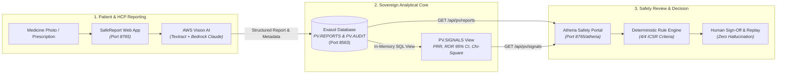

# Team Sovereign Health · Medical Valley Hackathon

Official team submission by **Sovereign Health** for the [Healthcare Hackathon Bayern, Erlangen](https://hackathon.medical-valley-emn.de/#challenges).

## Challenge

**Challenge 3: [Healthcare AI You Can Trust](https://hackathon.medical-valley-emn.de/healthcare-ai-you-can-trust/)** (Challenge Owner: **Exasol**)

> Build an AI-powered healthcare application that makes one meaningful healthcare problem much easier, for a patient, a hospital, a researcher, or another user we choose. It should not be just another chatbot.

### The Five Trust Requirements
1. **Actionable Insights:** Use healthcare data to generate useful and actionable clinical insights.
2. **Evidence Shown:** Show the verifiable ground-truth evidence behind every finding (exact quotes & offsets).
3. **Uncertainty Flagged:** Recognize missing, conflicting, or uncertain information rather than guessing.
4. **Sufficiency Checks:** Make clear when available evidence is insufficient to draw a clinical conclusion.
5. **Human Responsibility:** Keep a human expert strictly responsible for the final regulatory decision.

---

## Our Project: SafeReport & Atheria

> **A sovereign, end-to-end pharmacovigilance platform that turns messy patient side-effect reports into evidence-backed safety signals — using AWS Vision AI for intake, Exasol in-memory SQL for real-time signal detection, and a tamper-evident audit trail where AI proposes, rules decide, and a human approves.**

Over 95% of adverse drug reactions go unreported due to complex forms, while generic conversational AI models hallucinate medical facts without evidence. Our platform closes this gap with two interconnected applications backed by a single source of truth:



---

## The Two Applications

| Application | Location | Target User | Key Capabilities |
| :--- | :--- | :--- | :--- |
| **SafeReport** | `safereport/` &rarr; `http://localhost:8765` | Patients & Healthcare Professionals | • Multi-modal prescription & blister pack OCR/vision extraction (AWS Textract + Claude).<br>• Pixel-level bounding box visualization.<br>• Conversational adverse reaction intake.<br>• Direct insertion to Exasol `PV.REPORTS` & SHA-256 chained `PV.AUDIT`. |
| **Atheria** | `PV Teams/atheria-web/` &rarr; `http://localhost:8765/atheria/?demo=1` | Pharmacovigilance & Safety Officers | • Live inbox reading reports from Exasol with `SafeReport · Exasol` badge.<br>• 4/4 ICSR criteria extraction with clickable text quote spans.<br>• Deterministic validity engine (`icsr_validity_v1.0`).<br>• Cryptographic **"Replay decision"** button verifying identical SHA-256 hashes.<br>• In-database signal disproportionality detection (Evans criteria, PRR, ROR). |

---

## How We Meet the Challenge 3 Rubric

| Challenge Requirement | How Our Architecture Solves It | Technical Implementation |
| :--- | :--- | :--- |
| **1. Actionable Insights** | Disproportionate reporting signals computed across 1,263+ reports to identify genuine drug safety risks early. | Exasol `PV.SIGNALS` analytical view computing PRR, ROR, and $\chi^2$ metrics. |
| **2. Evidence Shown** | Every extracted medical entity (patient, reporter, drug, adverse event) links to exact source quotes and character offsets. | Atheria ICSR detail pane with interactive highlighting and Amazon Textract geometry. |
| **3. Uncertainty Flagged** | Missing criteria (e.g., absent drug or missing patient age) are explicitly highlighted as gaps; the model never guesses. | Atheria rule engine flags missing fields as `POTENTIAL ICSR` or `NON-ICSR`. |
| **4. Insufficient Evidence** | Drug-event pairs with low case counts ($a < 3$) or below statistical significance thresholds are marked unconfirmed. | Evans criteria enforcement in Exasol SQL view and Atheria signal matrix. |
| **5. Human Responsibility** | AI only proposes structured facts; deterministic rules evaluate validity; human safety reviewers sign off on final submissions. | Atheria case sign-off workflow with cryptographic SHA-256 audit log. |
| **6. Data Sovereignty** | Patient data stays on-premise within the enterprise database rather than being exposed to third-party cloud analytics. | Local/SaaS Exasol in-memory engine storing all sensitive reports and audit chains. |

---

## Quickstart: Running the Platform

### 1. Prerequisites
* Python 3.10+ (with virtual environment in `safereport/.venv`)
* Docker running [Exasol Personal](https://docs.exasol.com/saas/personal/overview.htm) on `127.0.0.1:8563` (or credentials for [Exasol SaaS](https://cloud.exasol.com/databases))
* Optional: AWS credentials in `safereport/.env` for live Claude Bedrock & Amazon Textract vision extraction (falls back cleanly to demo OCR if absent).

### 2. Load the Exasol Database
Seed the local Exasol database with historical reports, audit events, and the analytical signal view:
```powershell
safereport\.venv\Scripts\python.exe db/load_exasol.py
```

### 3. Start the Unified Server
Run the FastAPI backend serving both SafeReport and Atheria:
```powershell
safereport\.venv\Scripts\python.exe -m uvicorn server:app --app-dir safereport --port 8765 --reload
```

### 4. Access the Applications
* **SafeReport (Patient / HCP Reporting):** [http://localhost:8765](http://localhost:8765)
* **Atheria (Safety Team Review Portal):** [http://localhost:8765/atheria/?demo=1](http://localhost:8765/atheria/?demo=1)
* **Atheria Triage Inbox:** [http://localhost:8765/atheria/?demo=1#/inbox](http://localhost:8765/atheria/?demo=1#/inbox)
* **API Documentation:** [http://localhost:8765/docs](http://localhost:8765/docs)
